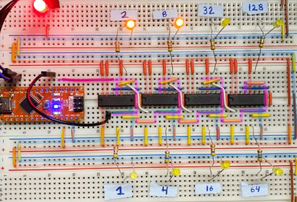
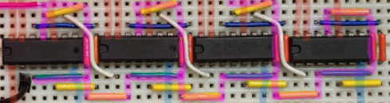

# UNPACKED 595: Shift Register GCD Calculator

An **8-bit shift register built from discrete D flip-flops** (four SN74HC74 chips) and driven by an Arduino Nano. The register stores and displays binary data on eight LEDs, and the firmware uses it to show the steps of a **greatest-common-divisor (GCD)** calculation in binary.

<p align="center">
  
</p>


## Overview

"UNPACKED" projects rebuild a familiar integrated circuit (here the 74HC595 shift register) out of its simpler parts. Each SN74HC74 holds two D flip-flops that capture a bit on a rising clock edge. Chained together, eight flip-flops shift data along one bit per clock pulse.

Rather than use buttons to clock data in, an Arduino Nano generates the clock and data signals in software, so low-level logic gets driven like a real serial interface.

**Circuit**

- Four SN74HC74N ICs form the 8-bit serial-in register
- Eight yellow LEDs (470 ohm resistors) display the Q outputs
- All clock inputs are wired in parallel to **D2**; all data inputs to **D3**
- PRE and CLR pins are tied to 5 V to keep them inactive
- Three indicator LEDs (blue, green, red) show the first number, second number and the GCD result

## Firmware

The sketch shifts values into the register bit by bit with a `displayBinary()` routine, holding each value on screen for five seconds. It starts with a test pattern, then shows two operands (for example 190 and 20) and the resulting GCD, while echoing everything to the serial monitor.

## Gallery

| Breadboard build | Flip-flop wiring (clock/data) |
|:---:|:---:|
|  |  |

## Repository layout

```
unpacked-595-gcd-calculator/
├── firmware/gcd_shift_register/   # Arduino sketch
├── docs/images/
├── LICENSE
└── README.md
```

## Build and run

1. Wire the four SN74HC74s as an 8-bit shift chain (Q of each stage feeds the next D), clock on D2, data on D3.
2. Upload `firmware/gcd_shift_register/gcd_shift_register.ino`.
3. Open the serial monitor at 9600 baud and watch the LEDs.

## What I learned

- How a shift register works at the flip-flop level
- Driving serial data and clock lines from software
- Turning a hardware exercise into something personal by adding a binary GCD calculation

## Credits and notes

Project 2.9 ("UNPACKED") of the Computer Engineering course (2025), based on the ACES task description. MIT licensed.
